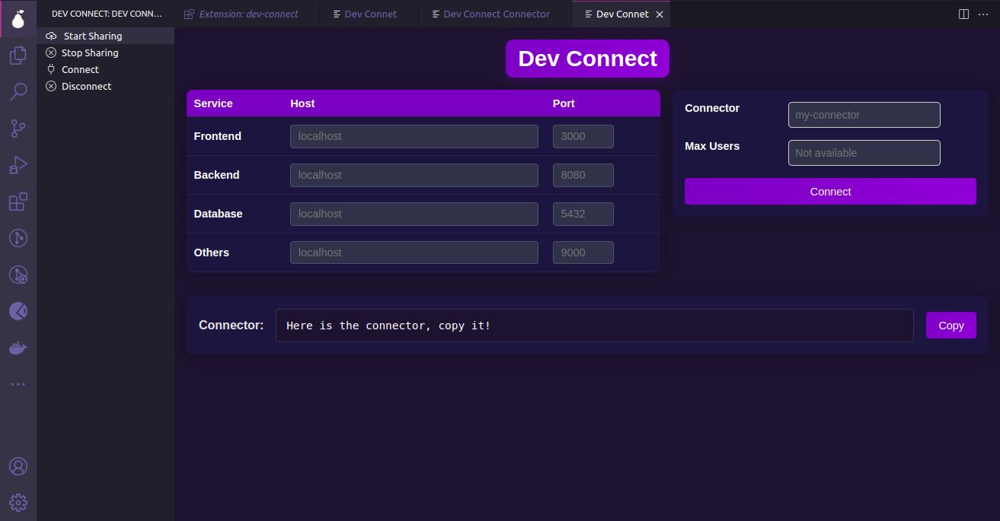
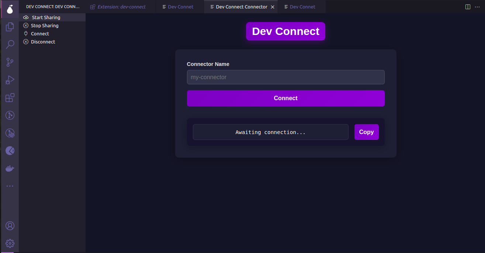
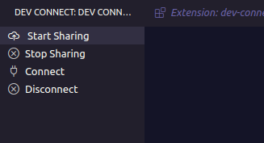
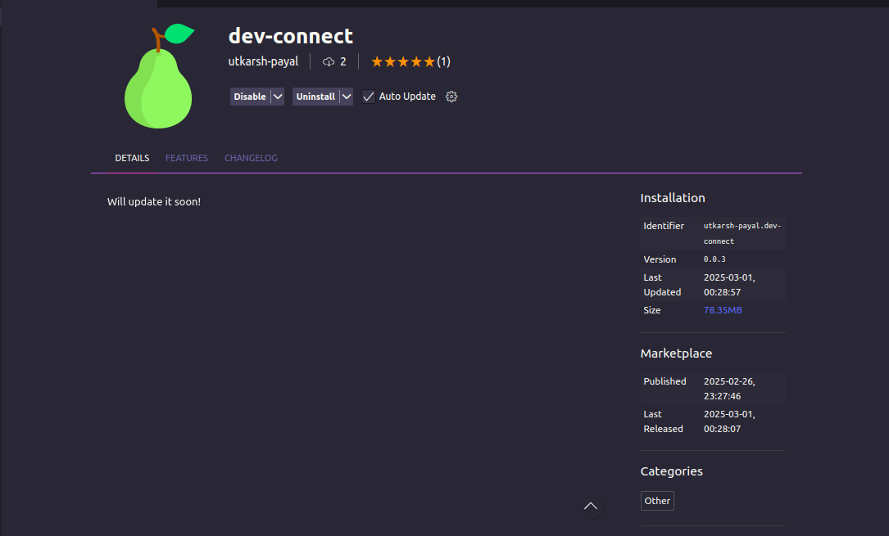

# Dev Connect

**Instantly share your localhost website with anyone in the world and see what your friends are building.**

## Features

- **Expose your localhost on the internet**
- **Connect to anyone's localhost through a connection key**
- **Multiport support**
- **Future goal:** Restrict the number of peers that can connect
- **Purely decentralized** – built using **Hypertele, Hyperswarm, Node.js, HTML, CSS, JavaScript, etc.**

## How It Works

Dev Connect provides a seamless way to share your development environment with peers without complex configurations. The platform offers four main options:

1. **Start Sharing** - Instantly expose your localhost to the internet
2. **Stop Sharing** - Close the connection and stop sharing
3. **Connect** - Connect to a peer's localhost using a connection key
4. **Disconnect** - Disconnect from a peer's localhost

## UI Preview

### UI for Sharing 

### UI for connecting

### UI of Options

### UI of Extension

## Technologies Used
- **Hypertele**
- **Hyperswarm**
- **Node.js**
- **HTML, CSS, JavaScript**

## Future Enhancements
- Implementing peer connection restrictions
- Enhanced security measures
- UI/UX improvements

## License
This project is open-source and available under the [MIT License](LICENSE).
